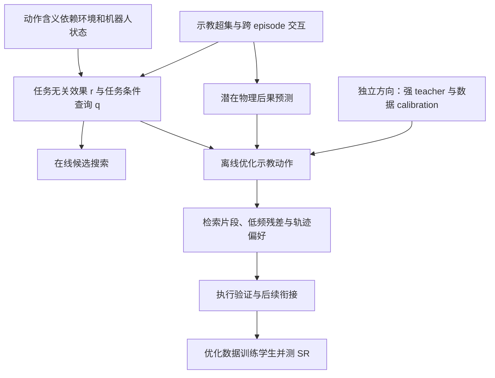

# CEAM 研究总览

这组材料记录 2026 年 9 月 26 日至 10 月 4 日的 CEAM 研究：条件动作双表征、在线候选搜索、
示教动作标签优化、跨 episode 物理知识、冻结 teacher 编辑和低频残差适配。
实测数据来自 LIBERO 仿真；外部论文结果与 CEAM 自己的实验分别标注。

主要结果是：候选中存在可执行的局部改进，明确的轨迹偏好监督能改善部分候选排序；
双表征相对普通 BC 或直接打分的稳定优势尚未确立，优化标签相对原示教的稳定学生策略收益也尚未确立。

## 阅读入口

| 内容 | 文档 | 回答的问题 |
|---|---|---|
| 完整历史 | [思路演变和 22 组实验](research_history.md) | 想法怎样变化，哪些实际做过，结果是什么 |
| 当前想法 | [条件效果与动作编辑](../../../idea/ceam/README.md) | 核心假设、输入输出与可替换机制是什么 |
| 框架定义 | [r 与 q 的职责](../../../idea/ceam/framework.md) | 哪些属于双表征定义，哪些只是实验实现 |
| 综合分析 | [证据支持什么](../../../synthesis/ceam/analysis.md) | 如何区分候选、排序、衔接与学生收益 |
| 文献调研 | [五组调研索引](../../survey/ceam/README.md) | 有哪些相关先例，各自不能说明什么 |
| 未完成方向 | [开放问题](../../../synthesis/ceam/open_questions.md) | 下一步需要验证什么，而非默认成立什么 |
| 实测数据 | [八份结构化结果](evidence/README.md) | 如何核对关键数字、种子和分母 |
| 来源与协议 | [档案索引](../../../synthesis/ceam/archive/README.md) | 原始结果、实现诊断和实验计划在哪里 |

## 关键结果

| 问题 | 实测结果 | 结论范围 |
|---|---|---|
| 在线 match 是否优于普通 BC | Goal：R6_all match 90.2%，四轮交互后 90.7%，无 ψ BC 92.7% | 当前选择器未胜过 BC；四轮差异不显著 |
| 明确成败对比是否足够 | 聚焦 query 训练后完整闭环降到 80.5% | 该固定表征与采样配方出现泛化退步 |
| 大规模任务基线 | LIBERO-90 BC 12,563/13,500，93.06% | 双表征 LIBERO-90 对照仍未完成 |
| 改标签是否改善学生 | 原始 88.93%，随机编辑 87.13%，引导编辑 90.27% | 引导相对原始 +1.33 个百分点，95% 区间 [−0.73,+3.40] |
| 数据内有无更优片段 | 物理检索在 71/90 个起点找到成功且更快 donor | 来自原示教后续下的执行验证，不是独立策略性能 |
| 偏好能否学到 | 排序 52.79%→61.49%→69.98% | 对应冻结、学习 query、同时适配 r；跨候选分布迁移较弱 |
| 低频残差有无价值 | 原动作附近找到联合质量改进 16/20；donor 低频 11/20；IID 2/20 | 完整候选库大小不同；等预算下 donor 残差没有胜过直接 donor 的平均省步收益 |
| 双表征是否优于直接打分 | 最新同输入对照：直接 MLP 69.59%，双表征 59.52% | 是候选对排序，不是策略 SR；两者均使用已有冻结特征 |

## 研究关系

## 证据边界

策略 SR、分支成功率、候选排序准确率和几何误差衡量不同环节。示教整体更快不要求每一步更快；
低延迟推理也不等于固定控制频率下物理任务耗时更短。

现有的“合法”是命令、关节范围和采样接触的物理筛查，不是连续时间或实机认证。
保留原始成功候选并在执行后择优，可以保持该候选库的成功；这不能证明学习器会提前识别成功。

这里的 88.93% 学生原始对照与历史 92.67% BC 基线使用不同的特征缓存版本，不适合横向归因。
多数后期实验覆盖固定任务和少量已被查看的留出 episode，不代表未见任务泛化。

研究记录对应 CEAM 提交 `713f20f`。导入文件、原文校验和、公开文件校验和及路径映射保存在
[来源清单](../../../synthesis/ceam/source_manifest.json)。完整训练代码、数据集、视频与模型权重属于独立 CEAM 实现，
本分支保存研究证据及汇总，不构成可直接运行的训练仓库。
