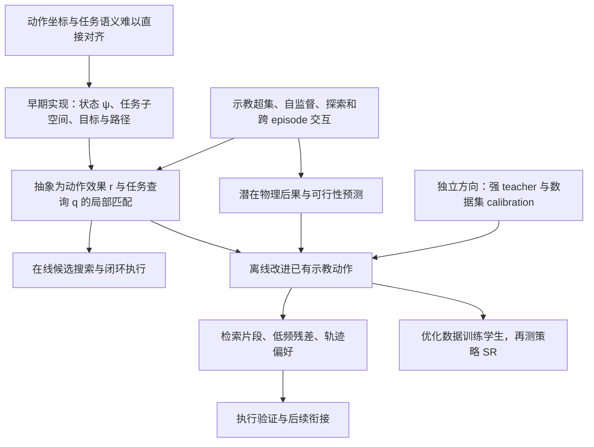
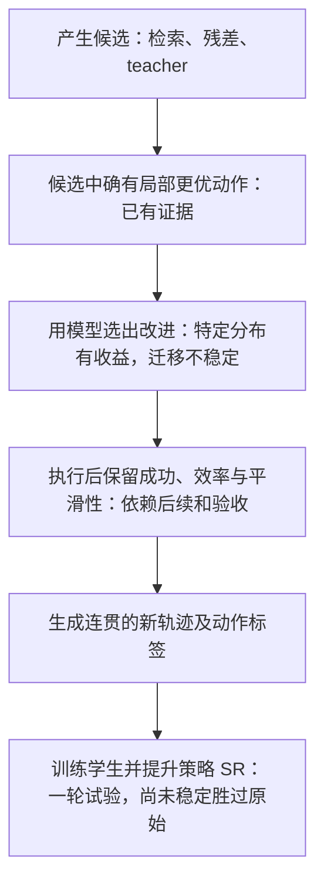

# CEAM 思路演变与实验结果

本报告覆盖仓库建立至 2026 年 10 月 4 日的主要研究过程。最早提交是 `4d37a9e`，时间为
2026 年 9 月 26 日 18:28 EDT；实验记录截至 `49a900d`，当前工作状态截至 `551c71b`。
日期均按美东时间。早期实验按阶段合并，日期表示执行或结果入库所在时段，不表示想法首次产生的精确时间。

贯穿项目的问题是：如何把“当前动作会产生什么效果”和“当前任务需要什么效果”分开学习，再利用这种结构选择或改进动作。
研究先验证在线动作选择，随后增加离线示教优化，并开出冻结 teacher 编辑这一独立方向。
目前已找到可执行的局部改进，也测到了明确偏好监督的排序收益；双表征相对简单方法的稳定优势，以及优化标签相对原示教的稳定策略收益，仍未确立。

本报告汇总设计记录与实测结果，不替代 [框架定义](../../../idea/ceam/framework.md)。具体实验的原始报告拥有其协议与数值；未完成的方向见 [开放问题](../../../synthesis/ceam/open_questions.md)，原始状态记录保存在 `synthesis/ceam/archive/`。

## 读表约定

| 名称 | 含义 | 如何解读 |
|---|---|---|
| ψ | 早期实现中的状态表征 | 当前框架不要求必须存在 ψ，也不要求动作效果必须是 ψ 的差分 |
| r | 以观测、机器人状态和候选动作为条件的任务无关表征 | “任务无关”指编码接口不读取指令，不表示动作在不同状态下含义相同 |
| q | 以观测和指令为条件的任务查询 | 早期曾简化成只看指令的 q(l)；该简化不是当前框架要求 |
| π | 从观测、机器人状态和指令预测动作块的 BC 策略 | 同时可以充当候选生成器；“无 ψ π”仍使用冻结视觉和文本表征 |
| 策略 SR | 策略从 benchmark 初始状态闭环执行后的任务成功比例 | 只有这种评估可以直接回答新训练策略是否更会完成任务 |
| 分支成功率 | 从某个中途状态执行候选，再接指定后续时的成功比例 | 强烈依赖起点、后续执行和时限，不能代替完整策略 SR |
| 排序准确率 | 同一起点上，模型对有明确优劣的候选对排序正确的比例 | 大量候选对共享少数 episode，不能按独立样本理解 |
| Oracle | 已执行全部候选，再用真实结果挑出的最好候选 | 表示固定候选库里的改进空间，不是可直接部署的学习器 |
| 通过物理检查 | 满足该实验的命令、关节范围及采样接触检查 | 不代表连续时间碰撞保证或实机安全认证 |

## 核心想法及其验证程度

下表的前两列记录研究主张，后两列记录实际采用的机制和证据。PCA、DCT、冻结 DINOv2、十步动作块等属于具体实验选择。

| 编号 | 想法 | 已做的具体工作 | 当前证据与边界 |
|---|---|---|---|
| I0 | 任务可以约束状态表征中的部分方向；成功终态在任务相关子空间内等价，执行可表现为潜在路径 | 初始 ψ、语言子空间 U、目标 ĝ、路径与终点损失；后续线性插值实验 | 能塑造部分离线几何，但有任务区分和退化问题，没有得到稳定控制优势。固定步长、线性路径、固定目标均不再是框架要求 |
| I1 | 动作虽低维，其语义依赖观测和机器人状态，应建模 r(o,a,state) 与 q(o,instruction) | 从 ψ 差分与方向查询，发展到明确的 r/q/m 接口；候选采样器独立 | 能在部分候选分布上优于随机选择；尚未稳定胜过直接 BC 或相同输入的直接打分器 |
| I2 | 执行任务是随观测反馈反复对齐、搜索的过程 | 每执行一个动作块便重新观测、生成候选并评分；试过状态条件查询 | 闭环机制已实现；不要求每一步更快或 match 单调增加。“成功轨迹累计 match 为正”这一弱约束的有效性尚未验证，它本身不排除失败轨迹也得正分；点积替代余弦的系统对照也未完成 |
| I3 | 动作表征应从示教的超集、自监督目标与探索中学习；JEPA 是方法族示例，SIGReg 只负责部分非坍缩约束 | 示教、扰动、失败 rollout、平滑随机动作、迭代交互；联合预测训练及固定 PCA 的 R6 对照 | 数据能改善特定候选的效果预测；全局多样性、较低预测损失没有自动转成精细排序。尚未完成充分的下一代可训练编码器方法对照 |
| I4 | 从直接选动作转向改进已有 action label；更快完成、更短路径、更少抖动且合法即可，不要求全局最优 | 一个动作块的离线替换、仿真验收、重新渲染、九个 BC 学生；显式时间与路径偏好训练 | 局部轨迹确实可改进；唯一完整学生对照相对原示教 +1.33 个百分点，区间包含零。快的整段轨迹不意味着每一步速度都更大 |
| I5 | 其他 episode，甚至整体观测不同的数据，可以提供共享交互知识；潜在物理表征可帮助判断动作后果 | 结构化物理状态预测、置信度校准、跨任务 ridge 诊断与文献调研 | 能预测粗略后果；尚不能可靠免去执行验证。没有训练从图像重建完整 3D 场景的系统，跨任务诊断也没有实现共享物体动力学的神经模型 |
| I6 | 仿真验证可以成为探索反馈，match 可以连接 RL | 收集同起点多候选的成败、训练 query、迭代交互；调研长期表征和偏好方法 | 反馈学习已试；没有完成 match 奖励驱动的 RL 对照。RL 超集、多任务优于 RL 都未建立 |
| I7 | 用已有强 VLA/WAM 和场景数据作 calibration，输出指定位置的改进动作；数据可压缩、归一化或形成 codebook | 独立冻结 π0.5 teacher，动作反演、噪声空间编辑、数据方差校准 | teacher 能生成部分改进候选，简单校准没有稳定优于未校准编辑。没有训练以 teacher 权重和全数据集为条件的生成器、学习 codebook 或完成蒸馏/SFT 对照 |
| I8 | 数据集中检索有偏好的动作片段，再用低秩残差适配；保留原动作，进行有条件的替换 | 几何/物理近邻检索；DCT 时间低频残差；原动作附近与 donor 附近两类编辑 | 找到更优片段的可用性已有证据；低频残差在控制抖动时优于 IID 扰动，但没有稳定优于直接 donor 的平均收益。尚未学习残差生成器或验证多片段联合组合 |
| I9 | 简单优化还包括几何重采样、时间分配和按语义删除冗余操作 | 阅读 G2 几何参考、动作标签优化文献；试过半幅动作与平移命令均值化等小对照 | 完整 G2 方案未复现；命令均值化不等于几何重规划。语义删除、可变时长和阶段级编辑尚未做本地实验 |

I0 的历史来源是初始 `plan.md` 与 [阶段一设计审计](../../../synthesis/ceam/archive/docs/stage_one_design_audit.md)。I1–I3 的当前语义见
[框架定义](../../../idea/ceam/framework.md)。I7 是独立的动作编辑方向，不要求归入双表征架构。

## 早期表征和在线选择实验

| 编号与时段 | 检验的问题 | 主要实测结果 | 结果的解释 |
|---|---|---|---|
| E01 · 9 月 26 日 | 目标子空间与指令对比能否区分任务效果 | 最终指令对比版各时间区间的示教效果排序约 0.92–0.98，共同起点任务区分 0.87 | 较容易的离线效果区分成立；使用已观察效果，不等于能预测并选好相近的新动作。[来源](../../../synthesis/ceam/archive/docs/stage_one.md) |
| E02 · 9 月 27 日 | 检索示教动作再 match，能否闭环完成任务 | 修正夹爪 reset 后，随机 6.0%；库内已观察效果打分 28.8%；预测效果 25.6%；加入扩大检索规则后 31.2% / 26.6%。各 500 局，单种子 | 相对随机有实际控制作用，但候选覆盖和偏离示教状态后的检索严重限制成功率。“已观察效果”来自库中原转移，不能当作当前状态反事实先知。[来源](../../../synthesis/ceam/archive/docs/closed_loop_mvp.md) |
| E03 · 9 月 27 日 | 更强的线性路径/进度约束是否改善选择 | 投影插值的时间相关达到 0.998，却未改善主要选择指标；一版完整空间训练有效秩降至 1.1 | 训练出漂亮的进度几何不足以支持动作选择；完整空间异常还含正则覆盖和未受约束目标分量问题，不能归为所有自监督表征失败。[来源](../../../synthesis/ceam/archive/docs/summary_2026-09-27_afternoon.md) |
| E04 · 9 月 27–28 日 | 有效 BC 候选上，match 是否比直接执行均值好 | 早期单种子 π 均值 SR 82.8%，match 小扰动选择 58.4%、大扰动 12.0% | 好的候选生成器已经提供强动作，粗糙 match 会选偏；这组是早期实现，不与后来 R6 数字混为同一模型。[来源](../../../synthesis/ceam/archive/docs/summary_2026-09-27_afternoon.md) |
| E05 · 9 月 28 日 | ψ 能否提高 BC 的稳定性或数据效率 | 三个 ψ 版本平均 SR 85.3%、86.1%、87.3%；无 ψ π 为 92.7%。25% 数据时，无 ψ 86.9%，投影 flow ψ 52.7%；50% 为 89.9% 对 79.5% | 被测试的 ψ 没有给 BC 带来数据效率优势，低数据下差距更大。“无 ψ”仍有冻结 DINOv2/SigLIP，不是无表征模型。[来源](../../../synthesis/ceam/archive/docs/data_scaling.md)、[三种子基线](../../../synthesis/ceam/archive/docs/no_psi_baseline.md) |
| E06 · 9 月 28 日 | 在 π 已失败的位置搜索，match 能否救回任务 | 74,951 条分支；定版 q 的候选分支成功约 13.1%，原均值 1.2%，随机扰动 9.9%；同尺度候选排序 AUC 约 0.47–0.54 | 存在可救回的候选，部分收益来自扰动本身。起点专门来自失败局，这不是完整 benchmark SR。[来源](../../../synthesis/ceam/archive/docs/summary_2026-09-28_overnight.md) |
| E07 · 9 月 28 日 | 加失败终态负样本能否解决 query 过于宽泛 | 前半程示教胜过反向效果的比例 0.966→0.920；胜过其他任务近邻效果 0.967→0.930 | 该负样本配方未通过预设离线检查，后续闭环未执行；结果不否定所有失败数据学习。[来源](../../../synthesis/ceam/archive/docs/stage_one_failure_negatives.md) |
| E08 · 9 月 28–29 日 | 交互数据与 R6 是否保留同状态不同动作的区别 | R6_all 在留出平滑随机候选上的状态内 R² 为 0.425，π 近邻候选上为 0.069；旧联合训练出现过尺度退化 | 大差异候选较容易预测，相近有效动作仍难分；固定特征+PCA 是可用对照，不是已完成 JEPA 方法族验证。[来源](../../../synthesis/ceam/archive/docs/query_match.md)、[联合训练](../../../synthesis/ceam/archive/docs/interaction_training.md) |
| E09 · 9 月 28–29 日 | 状态条件 query、R6 和迭代交互是否提升完整闭环 | 初始 r/q 选择 84.3%，同候选随机 87.6%，π 均值 92.7%；R6_all 第 0 轮 90.2%，四轮后 90.7%，两者 p=0.69 | 换表征后能优于随机，但仍低于直接 π；四轮迭代没有明确收益。同起点正负共存组每轮只有 4–6 个，新标签未进入计划中的 q 训练。[来源](../../../synthesis/ceam/archive/docs/query_match.md)、[四轮结果](../../../synthesis/ceam/archive/docs/summary_2026-09-29_overnight.md) |
| E10 · 9 月 29 日 | 不依赖 BC 候选，match 能否筛选随机平滑动作 | 从示教 75% 处出发，随机选择成功 25.6%，match 48.1%；43 个起点×3 种子 | 是匹配具有任务信息的正证据；是后段起点上的继续执行，不是从 benchmark 初态开始的通用策略。去除已成功起点后仍有提升。[来源](../../../synthesis/ceam/archive/docs/query_match.md) |
| E11 · 9 月 30 日 | 同一起点明确收集正负候选，能否训练出更好的 query | 三种子 TRAIN 选中成功候选达到库内 oracle；完整闭环却由 90.2% 降至 80.5%，低于随机 87.6% 和 π 92.7% | 单纯补齐成败对比不足以解决泛化。结果否定这批数据与固定 R6 下的 query 配方，不等于双表征的一般性不可能。[来源](../../../synthesis/ceam/archive/docs/focused_experiment.md) |
| E12 · 9 月 29–30 日 | 扩到 LIBERO-90 的工程与 BC 基线 | 原始 90 个任务重生成保留 3,949 条示教；90×50×3=13,500 局，BC 12,563 次成功，SR 93.06% | 数据和普通 BC 基线完成；R6 重训及跨场景评估因归一化与拓扑接口问题尚未执行，没有 LIBERO-90 双表征优劣结论。[基线](../../../synthesis/ceam/archive/docs/libero90_baseline.md)、[待办](../../../synthesis/ceam/archive/plans/libero90_pending_work.md) |

E09 的 R6_all 与更早的 R6_nine 有区别。R6_nine 的报告主表约为 90.1%，部分渲染中断样本被排除；
上述总览使用后续完整评估的 R6_all 第 0 轮 90.2%。细节及敏感性分析保留在 `query_match.md`。

## 动作标签优化及最近的实验

| 编号与时段 | 检验的问题 | 主要实测结果 | 结果的解释 |
|---|---|---|---|
| E13 · 9 月 30 日 | 改动作标签后重新训练 BC，是否更好 | 30 条 TRAIN 示教各编辑一个十步块；九个学生、4,500 局。原始 88.93%，随机编辑 87.13%，match 引导编辑 90.27% | 引导编辑胜过该随机编辑对照；相对原始 +1.33 个百分点的区间为 [−0.73,+3.40]，未建立稳定提升。当前唯一完成的编辑后学生 SR 网格。[来源](../../../synthesis/ceam/archive/docs/demo_refinement_results.md) |
| E14 · 10 月 1 日 | 直接借用其他 episode 的近邻片段，是否有更好的动作 | 180 个候选库、1,618 条分支；物理检索在 71/90 个起点找到成功且更快的 donor。全部验后择优，均步数 113.267→109.456，约 −3.36% | 候选改进空间存在；直接 match 选择只有 85.56% 分支成功，原始为 100%。最快选择的 jerk 增加约 13.3%，快和稳不能互相替代。[来源](../../../synthesis/ceam/archive/docs/retrieval_refinement_results.md) |
| E15 · 10 月 2 日 | 从数据预测潜在物理后果，能否省去仿真 | 5,135 条示教窗口加实际分支训练；mixed latent128 在剩余留出集的效果 R² 0.658，平均最差部件 xyz 误差 22.26 mm；抓取变化召回 6.85% | 可学习粗略动作后果，但精度与接触事件能力不足。5/10/20 mm 校准门槛下均无候选被接受；这是全部拒绝，不是零误接受率。输入是仿真物理状态。[来源](../../../synthesis/ceam/archive/docs/physical_world_results.md) |
| E16 · 10 月 2 日 | 明确教模型“成功且更快/更短”，偏好能否进入表征与查询 | 留出偏好准确率：冻结 match 52.79%，固定 r 学偏好 61.49%，适配 r 学偏好 69.98%。验后短名单相对随机节省 0.0375 秒、10.83 mm 路径 | 偏好反馈有用，固定 r 也能受益，因此收益不全来自 r。直接选择仍有失败，未训练学生；当时未以 jerk 作为学习目标。[来源](../../../synthesis/ceam/archive/docs/preference_feedback_results.md) |
| E17 · 10 月 2 日 | 同一候选的好坏是否依赖后面的动作 | 239 个候选分别接原示教与冻结 π：19.25% 成功标签变化；两边都明确有序的候选对中 42.63% 顺序反转 | 短片段的长期价值依赖后续。排除恢复不一致的两个起点后现象仍存在；不能据此判定用编辑数据训练的新学生必然失败。[来源](../../../synthesis/ceam/archive/docs/continuation_sensitivity_results.md) |
| E18 · 10 月 3 日 | 不同任务的数据能否学到共享效果 | 360 个 CPU ridge 拟合；同任务交互模型效果 R² 0.4817，其他任务训练为 0.0012，其中 EEF 0.2209、物体 −0.4622 | 测到有限 EEF 迁移，没有可靠物体交互迁移；目标任务删去时有些接触类型也完全消失，且模型未共享物体动力学参数，不能排除更合理的跨 episode 学习。[来源](../../survey/ceam/cross_episode_representation_research.md) |
| E19 · 10 月 3 日 | 冻结强 teacher 的噪声空间加数据 calibration，能否产生更优标签 | 600 个 proposal 槽位；等幅三类各 144 个，满足联合偏好的数量：直接扰动 16、teacher 噪声 24、校准噪声 19。另有 36 条共同 teacher 后续诊断 | teacher 空间有可用候选；简单方差校准未确立附加优势。存在源轨迹 174→129 步的个例，但换后续不保持优势；没有学习生成器或训练学生。[来源](../../../synthesis/ceam/archive/docs/teacher_editing_results.md) |
| E20 · 10 月 4 日 | 低频残差能否提高动作编辑质量 | 20 个起点、1,473 个候选；5% jerk 容忍下，找到合格改进的起点数：原动作低频 16/20、donor 低频 rank6 11/20、直接 donor 10/20、donor IID 2/20 | 低频编辑有局部平滑性价值。完整候选库大小不同；等预算下 donor 低频没有胜过直接 donor 的平均省步收益。不是学习出的低秩生成器。[来源](../../../synthesis/ceam/archive/docs/residual_editing_results.md) |
| E21 · 10 月 4 日 | 相同输入和接近参数量下，双表征能否比直接打分更好 | 三种子直接 MLP 排序 69.59%，双表征匹配 59.52%；直接短名单相对随机 −0.349 步，区间 [−0.752,+0.026] | 这一分布上直接打分更好，连它也未建立稳定短名单收益。两者都读已有冻结 r/q 特征，不能解释为表征学习整体无用。[来源](../../../synthesis/ceam/archive/docs/residual_editing_results.md) |
| E22 · 10 月 4 日 | 优化过的片段能否接上共同策略；加入抖动监督是否解决排序 | 原动作低频编辑在源后续上改善 16/20，换冻结 π 后改善 3/20、成功 18/20；新增抖动目标后仍未确立短名单收益 | 衔接与选择仍是障碍；四轮诊断完成，没有发布本轮新标签或启动学生训练。恢复异常的敏感性子集结论一致。[来源](../../../synthesis/ceam/archive/docs/residual_editing_results.md) |

E20 的“合格改进”同时要求原始和候选成功、通过采样物理检查、时间不增、平移路径不增加超过
1 mm、jerk 不增加超过 5%，且时间或路径有严格改善。20 个原始分支都成功，但仅 18 个通过该物理检查。
去掉 jerk 限制时，直接 donor、两种 donor 低频、IID 和原动作低频都能在 17/20 个起点找到时间/路径改进。
因此低频优势主要体现为满足联合质量约束，不能据此宣称学到了更优语义策略。

E19 的 600 个槽位包含越界 proposal；非法候选保留预算并计失败，没有全部送入仿真执行。
teacher-only 还有 34 个联合偏好改进，但幅度和夹爪自由度不同，不能拿来作为等幅编辑的公平胜负结论。

## 真正完成的编辑后策略对照

这组结果最直接回答“优化动作标签之后，训练出来的模型是否更好”。每个单元独立训练 3,000 步，
随后跑 LIBERO-Goal 的 10 个任务×50 个初始状态；推理只用学生 π，没有在线 match 或仿真候选筛选。

| 训练数据 | 学生种子 0 SR | 种子 1 SR | 种子 2 SR | 合并 SR | 相对原始 |
|---|---:|---:|---:|---:|---:|
| 原示教，对被选 episode 做同样重渲染 | 90.80% | 89.20% | 86.80% | 88.93% | — |
| 随机短名单加真实执行验收的编辑数据 | 86.80% | 86.40% | 88.20% | 87.13% | −1.80 个百分点 |
| match 短名单加相同验收的编辑数据 | 88.00% | 89.40% | 93.40% | 90.27% | +1.33 个百分点 |

引导编辑相对随机编辑为 +3.13 个百分点，三个种子均为正；相对原始的三个种子差值是
−2.80、+0.20、+6.60 个百分点。相对原始的配对 95% 区间包含零，且该区间仅描述这些已训练检查点的
benchmark 不确定性，不包含未来训练种子的全部不确定性。

源轨迹成本与学生收益没有单调对应：随机编辑的源平均步数 112.63 比引导的 113.23 更短，
学生 SR 却更低。原始源为 117.70 步。两种编辑都只触及 390 条 TRAIN 示教中的约 30 条，
并共用一次来源选择与一组编辑配置。

这组的原始对照为 88.93%，历史普通 BC 基线为 92.67%。前者对选中 episode 使用 512 像素重渲染，
其余仍是旧 224 像素特征，训练数据版本不同；两组绝对 SR 不可直接归因为算法进步或退步。
完整机器可读证据是 `outputs/demo_refinement/pilot_v1/reports/policy_comparison.json`。

## 目前各环节走到了哪里

| 问题 | 当前判断 | 最相关的证据 |
|---|---|---|
| 数据内是否存在更好的局部动作 | 有 | 检索 71/90 起点有更快成功 donor；多类低频残差可满足时间、路径和抖动联合标准 |
| 偏好是否可以由模型学习 | 在已测分布上可以 | 显式偏好把排序从约 53% 提到约 70%；跨到残差候选后收益减弱 |
| 双表征是否已有稳定独特优势 | 没有建立 | 在线选择未胜过 π 均值；最近同输入直接 MLP 排序更好 |
| 能否只靠学习的物理表征替代执行验证 | 当前不能 | 约厘米级误差、抓取变化漏检、严格置信度门槛全部拒绝 |
| 好片段能否自然拼成更好轨迹 | 不能直接推出 | 换后续会改变成功和排序；多片段联合编辑尚未测试 |
| 优化标签是否能稳定提高新策略 SR | 尚未建立 | 唯一学生网格相对原始 +1.33 个百分点，区间包含零 |
| 核心双表征想法是否被整体否定 | 没有 | 已测的是特定编码器、目标、数据和采样器；同时这些负结果不能被当成架构优势已存在的证据 |

## 已讨论但尚未完成的方向

| 方向 | 已有工作 | 缺少的本地验证 |
|---|---|---|
| 示教超集上的下一代自监督表征 | 交互数据、SIGReg/预测训练基础、R6、文献核对 | 可训练编码器或适配器的受控方法网格，以及固定下游协议的增益 |
| match 与 RL 的结合 | 同起点成败和偏好反馈、长期匹配调研 | 相同信息、数据和预算下的实际 RL 学习与多任务对照 |
| 从图像学习可迁移物理交互 | privileged-state 预测和小型跨任务探针 | 视觉输入、物体关系共享、接触类型覆盖、未见交互/任务测试 |
| teacher 权重与数据集共同条件化的 action 生成器 | 冻结单个 teacher 的反演与局部噪声校准 | 学习式数据压缩/codebook、条件生成器、跨数据集适配及成本对照 |
| 用 calibration 或压缩改善蒸馏/SFT | 相关文献与接口分析 | 与同 teacher、同数据的直接 BC/SFT/蒸馏实验比较 |
| 语义冗余删除、可变时间分配、多片段残差适配 | 编辑目标和边界接口的设计，简单算子对照 | 整阶段或整轨迹实验，必要任务效果保留与片段边界验证 |
| LIBERO-90 双表征 | 数据、BC 基线、交互存储、接口设计 | 实现原生归一化与场景拓扑接口，再训练/评估 R6；当前仍是延期事项 |

相关调研保存在 [长期匹配](../../survey/ceam/long_horizon_matching_review.md)、[跨 episode 表征](../../survey/ceam/cross_episode_representation_research.md)、
[teacher 与 calibration](../../survey/ceam/teacher_dataset_calibration_review.md)、[action label 优化](../../survey/ceam/action_label_optimization_review.md)
及 [Agent4VLAData 参考](../../survey/ceam/agent4vla_reference_review.md)。其中的外部论文结果不计入 CEAM 自己的实验。

## 记录边界和当前状态

- 项目主体数据来自 LIBERO 仿真遥操作示教；后续增加实际仿真分支与策略 rollout。它们不是新采集的实机数据。
- Goal 现有 release 有 433 条示教，划分为 390 TRAIN 与 43 HELDOUT。重新生成时 433 条动作可精确对应，
  但严格末步成功为 432 条，部分 proprio 误差超过早期计划阈值；这些差异已实测记录，不能把最初计划写成已全部达到。[来源](../../../synthesis/ceam/archive/docs/libero90_prep.md)
- 多数后期 pilot 只覆盖固定任务与少量、已被研究查看的留出 episode；不是未见任务测试，也不是每轮全新研究测试集。
- 部分恢复存在数值敏感性，记录于 ISSUE-045；后续敏感性分析保留全部结果，同时单列候选阶段状态完全一致的子集。
- 本报告没有把不同 protocol 的成功率连成统一进步曲线，也没有把离线候选对数量当作独立机器人试验数量。
- 截至 `551c71b`，残差编辑四轮已完成，没有执行中的计划阶段；最后资源记录显示相关 workers 退出、GPU 释放。
  后续实现方向仍待具体实验设计，当前报告没有启动新实验。
