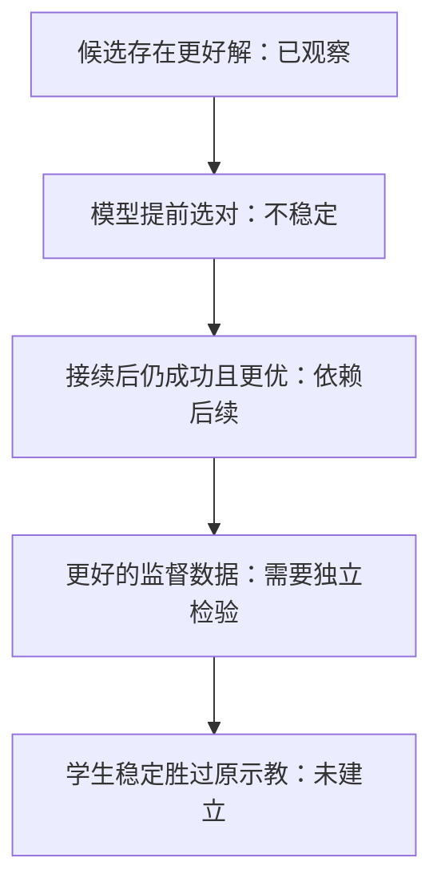

# CEAM 结果的解释

分析截至 2026 年 10 月 4 日。数值与协议见 [完整历史](../../docs/reports/ceam/research_history.md)
及其原始实验链接。下表区分实测现象、可支持的解释和仍未隔离的原因。

| 现象 | 可以支持的解释 | 不能据此认定 |
|---|---|---|
| 早期离线任务区分很好，闭环选择仍弱 | 容易的跨任务区分与相近动作选择是不同任务 | 模型已经学会行动质量或长期价值 |
| R6 对平滑随机候选预测较好，对 π 近邻较弱 | 候选分布决定需要保留的精细区别 | 增加全局有效秩即可解决控制 |
| 四轮交互更新没有增益，聚焦 query 闭环下降 | 当前数据、目标与固定表征组合泛化不足 | 所有探索、自监督或双表征都无效 |
| 明确偏好学习改善排序 | 成功之外的质量信息可以进入模型 | 这些偏好一定只能由 r 表达，或架构必然优于直接打分 |
| 检索和残差库中确有更优动作 | 原始示教不是局部效率上限 | 未经验证的直接拼接必然不退步 |
| 低频残差在联合抖动约束下好于 IID | 时间平滑性是有用的候选先验 | 已经去除了语义次优解，或学到了任务策略 |
| 换后续会改变成败和排序 | 局部动作的长期效用依赖后续执行 | 用连贯新轨迹训练的学生一定无法利用编辑 |
| 物理预测厘米级且漏检抓取变化 | 当前模型不足以替代严格执行验证 | 必须重建完整 3D 或所有潜在预测均不可行 |
| teacher 校准没有比未校准更稳定 | 当前简单方差校准没有附加质量证据 | 数据条件化、codebook 或更丰富生成器都无效 |

## 四个环节的证据

1. **候选可用性。** 原始加候选的完整库中，有些候选在实际执行后更快、更短或更平滑。这一层已有正证据。
2. **学习选择。** 模型必须在执行前挑出值得验证或采用的候选。偏好模型在旧分布有效，在新残差分布上优势减弱。
3. **轨迹衔接。** 候选的效果必须与后续兼容。原示教后续、冻结策略和重新训练的策略是不同的后续条件。
4. **学习收益。** 优化标签必须能被部署输入下的学生学到，并通过新策略评估体现价值。这一层只有一轮完整网格。

## 两个有解释力的反例

学生对照中，随机编辑的源平均步数为 112.63，引导编辑为 113.23；随机源轨迹更短，学生却是
87.13% 对 90.27%。这表明源轨迹单一成本并不能完整描述训练价值。它没有隔离差异来自哪类动作或观测。

teacher pilot 的一个编辑在原后续下把总步数从 174 减到 129；改用共同 teacher 后续的一个种子后，
原始为 136，编辑为 191。这个例子展示衔接的影响，但不是 calibration 的一般效果量。

## 当前优先辨认的问题

当前证据更支持先明确任务效果、后续条件、监督目标与验证分母，再比较结构。
仅扩大候选数、强化几何约束、增大表征维数或更换相似度，都没有自动解决上述各环节。
这是一项基于已有结果的研究判断；效果条件编辑、阶段级优化与学习式生成器的增益仍需新实验。

对下一轮有价值的对照包括：同输入直接打分、保留原始动作、同预算随机候选、直接 donor、
实际可用性 oracle、相同后续与相同训练协议。具体候选方向见 [开放问题](open_questions.md)。
